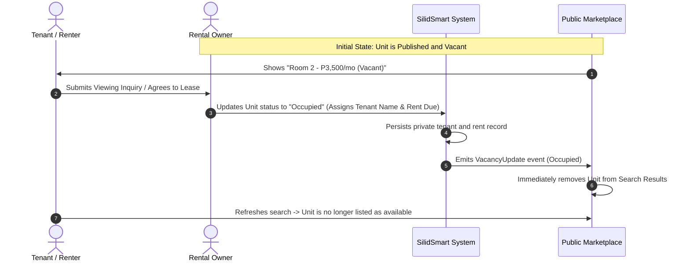

# Airbnb to SilidSmart B2B2C Workflow & Architecture Translation

## 1. Executive Summary

This document translates the standard **Airbnb/Booking.com Two-Sided Marketplace System Design** into the **SilidSmart B2B2C Rental Management Ecosystem**, as specified in the SilidSmart Stage 1 Business Model Canvas (BMC) and concept documentation (`SilidSmart_project.pdf`).

Airbnb connects transient travelers with short-term hosts through a high-frequency, commission-based booking model with centralized payment processing. In contrast, **SilidSmart serves small rental operators (boarding houses, dorms, and small apartment complexes) in the Philippines** through a **B2B2C SaaS model**:
- **B2B (Landlord Operations)**: Landlords subscribe to a private management tool for room/unit inventory, tenant rosters, and manual rent tracking.
- **B2C (Tenant Discovery)**: Renters search a free, public directory of verified vacancies without mandatory accounts or transaction fees.
- **Platform (Governance & Sync)**: The platform synchronizes private vacancy changes to the public marketplace in real-time, moderates listings, and verifies owner IDs.

---

## 2. Structural & Architectural Mapping

```
+----------------------------------------------------------------------------------------------------+
|                                    AIRBNB / BOOKING.COM ARCHITECTURE                                |
|                                                                                                    |
|  [Hotel/Host App] ---> [Hotel Service] ---> [Hotels DB MySQL] ---> [Kafka Message Broker]           |
|                                                                             |                      |
|                                                                             +--> [Search Consumer] |
|                                                                             |    --> ElasticSearch |
|  [Guest/Customer App] ---> [Search Service] <-------------------------------+                      |
|                      ---> [Booking Service] ---> [Bookings DB] + [Redis Lock] + [Payment Gateway]  |
|                                                                                                    |
|  [Management App]    ---> [Booking Mgmt]   ---> [Cassandra] + [Spark/Hadoop Analytics]             |
+----------------------------------------------------------------------------------------------------+
                                                 |
                                                 |  TRANSLATION TO SILIDSMART
                                                 v
+----------------------------------------------------------------------------------------------------+
|                                    SILIDSMART B2B2C ARCHITECTURE                                   |
|                                                                                                    |
|  [Owner/Landlord UI]  ---> [Property & Unit Service] ---> [Private DB (Units, Tenants, Rent)]      |
|                                                                     |                              |
|                                                                     +--> [Vacancy Sync Engine]     |
|                                                                          (Status: Vacant/Occupied) |
|                                                                          |                         |
|  [Customer/Renter UI] ---> [Public Search Directory] <------------------+                         |
|                       ---> [Inquiry & Viewing Service] ---> [Inquiry Queue (Zero-Commission)]      |
|                                                                                                    |
|  [Admin/Reviewer UI]  ---> [Platform Trust & Subscriptions]                                        |
|                            * Owner ID Review Queue ("Owner ID reviewed" badge)                     |
|                            * Listing Moderation & User Reports                                     |
|                            * Plans (1-4: Free, 5-10: P99, 11-25: P199, 26-50: P349, >50: Custom) |
+----------------------------------------------------------------------------------------------------+
```

---

## 3. Detailed Component Translation Matrix

| Airbnb/Booking.com Element | SilidSmart B2B2C Equivalent | Functional Translation & Behavioral Rules |
|---|---|---|
| **Hotel Manager UI/App** | **Owner (Landlord) Dashboard** | In Airbnb, hosts manage night rates, calendar availability, and guest reviews. In SilidSmart, owners manage physical rooms, bedspaces, and apartment units, maintaining **private tenant records** and **manual rent payment ledgers** (due, paid, overdue). |
| **Hotels Service & DB Cluster** | **Property & Unit Inventory Store** | Stores private owner data. **Privacy Boundary**: Tenant names, phone numbers, payment statuses, and private owner notes are strictly encapsulated and NEVER exposed to public APIs or views. |
| **Kafka Event Stream** | **Vacancy State Transition Engine** | Emits atomic `UnitAvailabilityChanged` events. When an owner toggles a unit from "Vacant" to "Occupied" (or registers a tenant), the event instantly delists the unit from the public search directory. |
| **ElasticSearch Cluster & Search Service** | **Public Marketplace Search Directory** | Public search indexed exclusively on `published = true` AND `status = 'Vacant'`. Supports filtering by Area (e.g. Sample City North, Central, East), Rental Type (Boarding house, Apartment, Dorm), and Monthly Rent (`P`). |
| **Customer App (Search & Booking)** | **Customer (Tenant/Renter) Portal** | Free, unauthenticated public discovery. Renters compare cards showing owner-stated rent, deposit, house rules, amenities, and `Availability last updated by owner: [date]`. |
| **Booking & Payment Service** | **Viewing Inquiries and Private Short-Stay Ledger** | Viewing requests remain free inquiries, not reservations. Owners manually record completed stays; eligible SilidSmart-sourced rent calculates 5% owner-paid commission on every tier. Cancelled/other-source stays calculate zero. No payments, deductions, escrow, verification, or fee collection. |
| **Booking Management & Archival (Cassandra/Hadoop)** | **Admin / Reviewer Operations & Metrics** | Reviewers manage the **Owner ID verification queue** (granting "Owner ID reviewed" status; strictly disclaiming safety certification), process listing issue reports, and monitor subscription tier distribution. |

---

## 4. End-to-End Workflow Comparison

### A. Supply-Side Onboarding & Inventory
- **Airbnb**: Host lists whole property or private room -> sets nightly pricing calendar -> instant booking or approval toggle.
- **SilidSmart**:
  1. Landlord registers properties and adds rooms/apartments.
  2. Landlord logs current occupancy (e.g. Room 1 occupied by Juan, Room 2 vacant).
  3. Landlord marks Room 2 as "Vacant" and clicks "Publish to Directory".
  4. Listing goes live with stated rent (e.g. ₱3,500/mo), rules, and amenities.

### B. Demand-Side Discovery & Connection
- **Airbnb**: Guest searches dates/guests -> views calendar rates -> checks out with credit card -> host receives payout minus 15% platform fee.
- **SilidSmart**:
  1. Renter browses public directory without login or booking fees.
  2. Renter filters by Area, Type, and Budget.
  3. Renter inspects listing: rules (e.g. 10 PM curfew, female-only), amenities (WiFi, submeter), owner ID review badge, and last update date.
  4. Renter submits an inquiry/viewing request or contacts the owner directly.
  5. The platform takes ₱0 commission on rent.

### C. Occupancy Sync (The Core Value Proposition)


---

## 5. Subscription & Financial Mechanics (BMC Alignment)

| Metric / Dimension | Airbnb Model | SilidSmart BMC Model |
|---|---|---|
| **Primary Payer** | Guest/host fees vary by booking model | **Owners** (capacity-based subscriptions plus eligible short-stay fees; Free monthly tier for 1–4 units) |
| **Renter Cost** | Depends on the current platform fee structure | **₱0 to browse and inquire** |
| **Pricing Metric** | Booking-based fees | **Unit-count monthly tiers plus 5% of completed SilidSmart-sourced short-stay accommodation rent** |
| **Free (1–4 units)** | N/A | **₱0 / month; separate short-stay rule still applies** |
| **Tier 1 (5–10 units)** | N/A | **₱99 / month** |
| **Tier 2 (11–25 units)**| N/A | **₱199 / month** |
| **Tier 3 (26–50 units)**| N/A | **₱349 / month** |
| **Enterprise (>50 units)**| Custom enterprise contract | **Custom monthly quote** (No 50-unit platform limit) |
| **Payment Flow** | Centralized Stripe / credit card processing | Manual rent collection outside the platform |

---

## 6. Mandatory Disclaimers & Privacy Guardrails

1. **Persistent Demo Label**: `Concept prototype - sample properties only`
2. **Owner ID Review Label**: `Owner ID reviewed` accompanied by `This does not certify property safety`.
3. **Availability Timestamp**: `Availability last updated by owner: [date]`. Never promises "guaranteed available".
4. **Tenant Shielding**: Public pages must never expose tenant names, contacts, rent records, or private notes.
5. **No False Promises**: The platform organizes rental information digitally; it does not promise AI, smart-home hardware, or legal lease certification.
